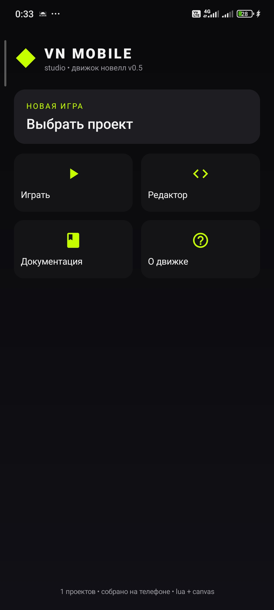
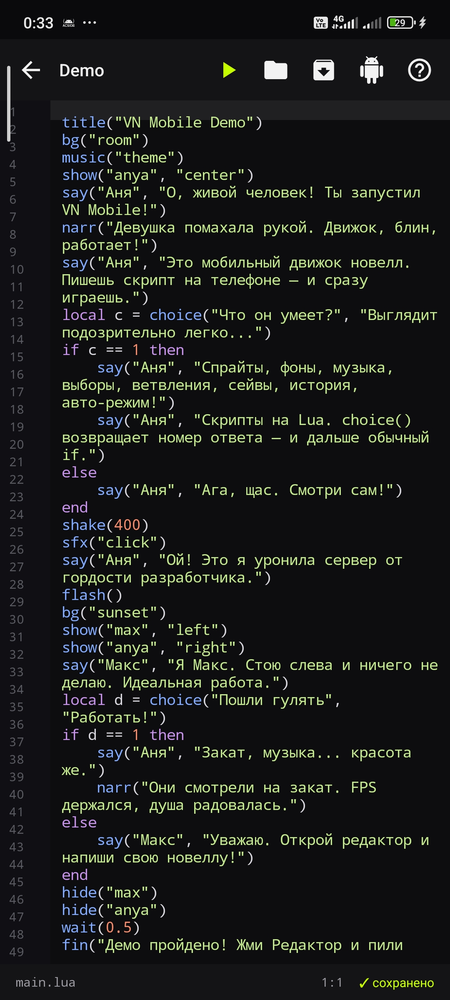
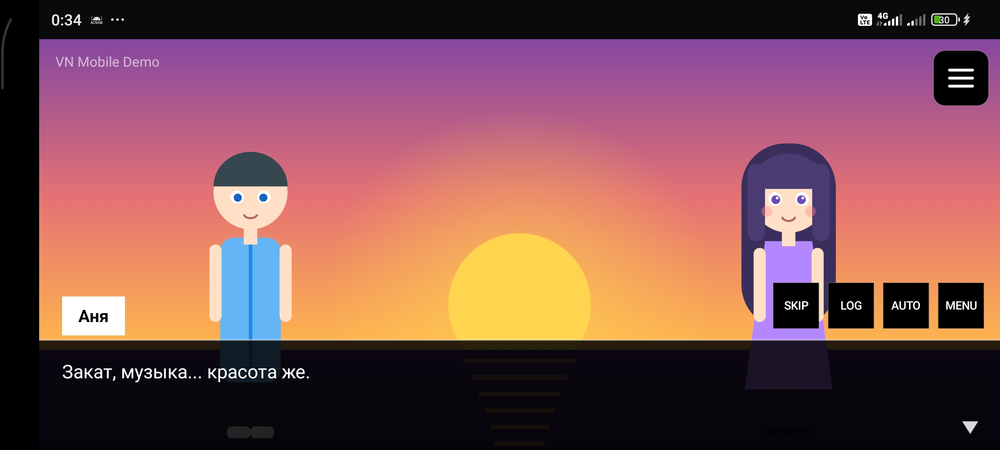

# VN Mobile 📱🎭

**A visual novel engine that lives entirely on your phone.**
Write Lua scripts, import art from your gallery, play instantly — and export a standalone APK of your novel, signed on-device. No PC required. Ever.

> Движок визуальных новелл, который полностью живёт на телефоне: Lua-скрипты, импорт артов из галереи, мгновенный запуск и экспорт готовой игры в отдельный APK прямо с устройства.

   

## Screenshots

| Home & Studio | Script Editor (Lua highlighting) | In-game |
|---|---|---|
|  |  |  |

## Features / Фичи

- 🎭 **Lua scripting** — branching, variables, loops, functions: real Lua, not a toy DSL
- 🖼️ **Renderer** — backgrounds with crossfade, sprites (left/center/right or custom x), typewriter text, shake/flash effects
- 💾 **Saves** — autosave on every line + 6 manual slots, load rewinds the script to the exact replica (choices replayed)
- 📜 **History / Auto / Skip** — full Ren'Py-style quick menu under the textbox
- 🎨 **Skin system** — custom textbox frame, namebox (top/center modes), custom buttons with pressed/active states, custom fonts, title background — just drop files into `theme/`
- 🏠 **Title screen** — Start / Load / Settings / About / Exit, generated per project
- 📱 **APK export on-device** — the engine repackages ITSELF as a template, injects your novel, patches the package name (unique per game, installs side-by-side) and signs it with an Android Keystore key (apksig v1+v2+v3)
- ✏️ **Built-in editor** — Lua syntax highlighting, line numbers, current-line highlight, status bar
- 🔊 **Audio** — looping music + SFX channels with per-channel volume
- 🌗 **Monochrome Ren'Py-style in-game UI**, landscape-locked gameplay

## Script example / Пример скрипта

```lua
title("My Novel")
bg("room")
music("theme")
show("anya", "center")
say("Anya", "Hello! This runs on a phone, baby!")
local c = choice("What can it do?", "Looks too easy...")
if c == 1 then
    say("Anya", "Sprites, saves, skins, APK export!")
else
    shake(400)
    say("Anya", "Then watch this.")
end
bg("sunset")
fin("To be continued...")
```

## Theming / Скины

Drop files into `<project>/assets/theme/`:

| File | Purpose |
|---|---|
| `box.png` | textbox frame (stretched full-width) |
| `namebox.png` + `namebox_mode.txt` (`top`/`center`) | name plate frame + position |
| `btn_skip.png` / `_on.png` / `_p.png` (also `auto`, `log`, `menu`) | custom quick-menu buttons with states |
| `font.ttf` / `font_ui.ttf` | dialogue / UI fonts |
| `title.png` | title screen background |
| `about.txt` | "About" screen text |

Or switch skins at runtime from Lua: `ui.box("box.png")`, `ui.namebox("namebox.png","center")`, `ui.font("font.ttf")`.

## Building / Сборка

The project is a plain Gradle Android app (Kotlin, minSdk 24). It was developed **entirely on a phone** in [AndroidIDE](https://github.com/AndroidIDEOfficial/AndroidIDE), but opens in Android Studio as well. Dependencies: LuaJ (scripting), apksig (on-device signing).

## Roadmap

- [ ] Weather & particles (snow/blizzard/rain/petals, custom sprites with auto trajectories)
- [ ] Sprite animations (breathing, blinking), scene transitions (dissolve/wipe/slide)
- [ ] Camera system (zoom/pan/focus)
- [ ] Character objects: `anya = Character("Anya", color=...)`
- [ ] Save thumbnails, CG gallery, endings statistics
- [ ] Lean cartridge template (strip editor dex from exported games)

## License

MIT — see [LICENSE](LICENSE). Free as in freedom: Ren'Py lawyers can't touch us, we wrote every line ourselves 😈

---

*Made with rage, love and a mobile internet that hates pacman. Собрано на телефоне, блять.*
EOF
